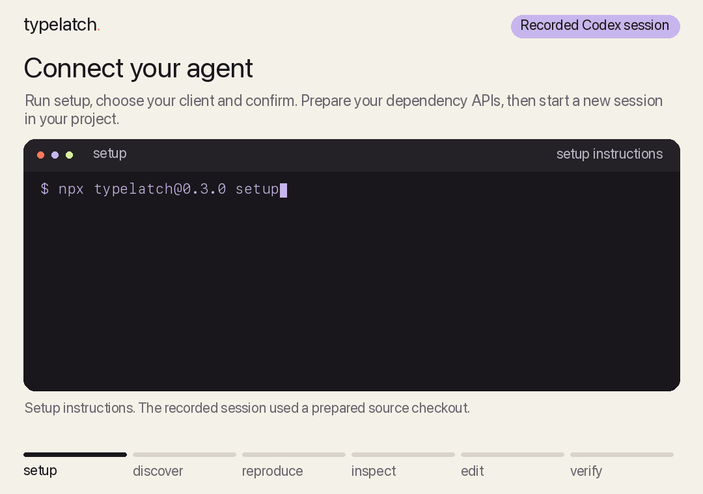
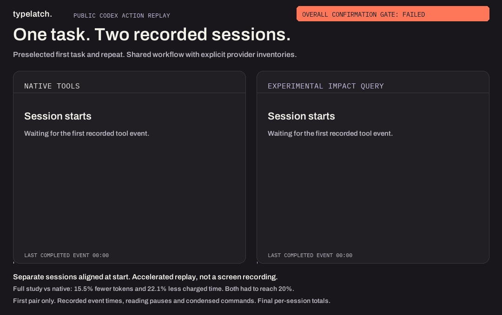
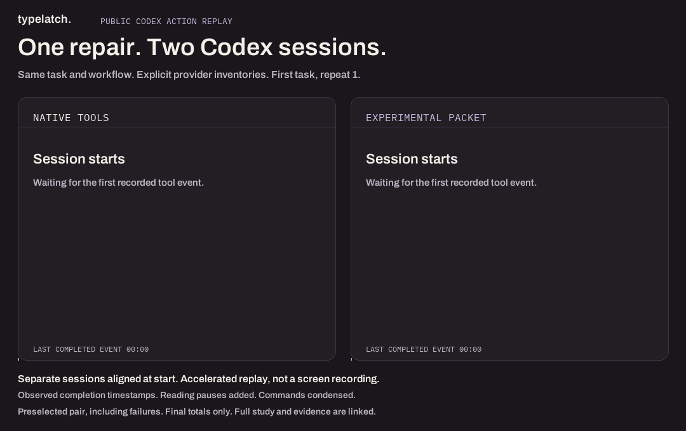

# Typelatch

[](https://www.npmjs.com/package/typelatch) [](https://nodejs.org/) [](LICENSE)

**Find the right source. Inspect the exact API. Verify the change.**

Local workspace search and package API evidence for coding agents. Give Codex or Claude Code a question. Typelatch finds relevant source and exact dependency APIs, then helps the agent check its work with your TypeScript compiler and tests.

[Website](https://edimka.github.io/typelatch/) · [npm](https://www.npmjs.com/package/typelatch) · [Usage](docs/USAGE.md) · [Changelog](CHANGELOG.md)

[](https://edimka.github.io/typelatch/#walkthrough)

*Setup instructions followed by a visual summary of an actual Codex session. Timing is edited for readability. [Inspect the requests, edit and test results](docs/showcase/codex-session.md).*

## Connect. Ask. Build.

Requires Node.js 22.12 or newer, npm, Bash, and the Codex or Claude Code CLI.

```sh
npx typelatch@0.3.0 setup
```

These commands install the published 0.3.0 release. [Unreleased development](https://github.com/eDimka/typelatch/pull/3) is tracked separately.

Choose your client and confirm registration. Start a new client session in your project, then ask:

```text
Use workspace_search to explain how this project is organized.
Find the implementation and tests relevant to my change.
Inspect the exact dependency API before editing.
```

Setup pins the exact Typelatch version it registers. There is no global installation or repository clone to maintain. [Manual registration and upgrades](docs/USAGE.md#install-and-connect).

To prepare your direct dependency APIs, run this inside a project with a supported lockfile:

```sh
npx typelatch@0.3.0 sync
```

Source discovery works without this preparation. Missing indexes and preparation commands stay visible in search results. For a monorepo, save the projects you want to search and sync:

```sh
npx typelatch@0.3.0 scope add apps/web packages/ui
npx typelatch@0.3.0 sync
```

The published package supports npm package locks and shrinkwrap, pnpm, Yarn Classic and modern Yarn, and Bun text locks. Binary Bun and Deno npm support are [unreleased additions](https://github.com/eDimka/typelatch/pull/3). [Supported formats and limits](docs/USAGE.md#library-discovery) · [Project scopes](docs/USAGE.md#keep-a-monorepo-subset).

## Start with a question

An agent often starts by guessing filenames and repeating text searches. Typelatch gives it a workspace entry point: source, internal declarations, tests, docs, configuration and available dependency indexes in one ranked response.

```json
{
  "name": "workspace_search",
  "arguments": {
    "workspaceRoot": "/absolute/path/to/your/project",
    "question": "Where do we validate incoming requests?",
    "detail": "compact",
    "limit": 8
  }
}
```

Results carry source locations, exact package versions and visible coverage gaps. The index refreshes from current file contents. Use `detail: "source"` when preparing an edit to include bounded file contents and direct relative import candidates. Your agent uses its normal tools for further inspection and editing.

Prefer the terminal?

```sh
npx typelatch@0.3.0 search "Where do we validate incoming requests?" --compact --json
```

## Codex with and without Typelatch

[](https://edimka.github.io/typelatch/#confirmation-benchmark)

The latest study covers a five package dependency migration, a cross package maintenance repair and impact analysis. **No tested category established a substantial, repeatable token and time advantage over native tools.**

The focused impact prototype saved 15.5 percent of tokens and 22.1 percent of time in the final 16 session comparison. It missed the required 20 percent reduction in both. Token savings fell to 1.5 percent in the second repetition. It beat the tested Serena and CodeGraph configurations, but native won the final pair. The prototype is separate from the published package. The accelerated replay shows the first pair selected before results, with the failed overall gate visible throughout.

[Full results, correctness audit and recorded actions](docs/research/cross-package/RESULTS.md) · [Interactive comparison](https://edimka.github.io/typelatch/#confirmation-benchmark)

### Earlier localized repair study

[](https://edimka.github.io/typelatch/#guided-benchmark)

The source experiment used **11.9% more tokens and 20.6% more time than native tools** on two real pnpm repairs. It did not meet the savings gate. This accelerated action replay uses the first pair, selected before results. The experimental tool is separate from the published package.

| Four sessions per condition | Native tools | Serena 2.1.0 | Source experiment |
| :--- | ---: | ---: | ---: |
| Grep shell calls | 9 | 6 | 4 |
| Total tokens | 361,367 | 636,774 | 404,262 |
| Agent time plus provider setup | 96.9 s | 130.8 s | 116.9 s |
| Correct solutions | 4/4 | 4/4 | 4/4 |

All conditions received the same tasks and workflow policy, plus an explicit inventory of their available tools. Tokens include cached input once. Both tasks are localized repairs inside an older 198 package pnpm snapshot. This does not establish a scaling advantage or a general ranking. [Every run, returned tool output and method](docs/BENCHMARKS.md#instructed-tool-use).

Earlier evidence remains available: the [0.4.0 package candidate](docs/benchmarks/typelatch-040-candidate/paired-agent.json) used 63.0% more tokens and 44.8% more charged time on three authored tasks. A separate [16 session availability study](docs/benchmarks/monorepo-agent-study/report.json) observed zero MCP use. [Original 0.3.0 results](docs/benchmarks/typelatch-use/paired-agent.json).

## From a bug to a checked change

In the [recorded Codex session](docs/showcase/codex-session.md), a failed contact import leaves rows behind. The prompt asks the agent to use Typelatch, without naming the implementation file, dependency or solution.

| Step | What the actual session establishes |
| :--- | :--- |
| Discover | One `workspace_search` returns the implementation, tests and package configuration, including their source. |
| Reproduce | Compilation passes. The existing rollback assertion fails. |
| Inspect | `workspace_context` resolves `Kysely.prototype.transaction` from `kysely@0.28.8`, with its signature and rollback documentation. |
| Edit | Codex wraps the parameterized inserts in one transaction. Only `batch.ts` changes. |
| Verify | Compilation and both unchanged tests pass. Recorded inputs stay stable. A separate test run confirms the result. |

The agent used **four MCP calls and one shell command**, `git diff -- batch.ts`. No `rg` or `grep` command appeared in its recorded shell actions. This is one prompted session on a prepared exercise. It demonstrates the workflow, not a measured saving against another agent or a guarantee of fewer tokens.

The retained session used `kysely@0.28.8`. The maintained SQLite example now pins `kysely@0.28.19`; a fresh capture uses that updated fixture.

[Inspect the complete public actions](docs/showcase/codex-session.json), or run a fresh Codex capture from a source checkout:

```sh
npm ci
npm run build
node scripts/capture-demo.mjs
```

The capture requires an authenticated Codex CLI. It prepares an isolated exercise and dependency indexes before the agent starts. [Capture checks and limits](docs/showcase/codex-session.md) · [Prepare the task for your own agent](docs/showcase/agent-workflow.md#give-this-to-your-agent) · [Benchmarks](docs/BENCHMARKS.md).

<details>
<summary>Inspect the original published package recording</summary>

The actual question in the recorded run:

> How can I import a batch of contacts into SQLite atomically, roll back every new row if a UNIQUE name constraint fails, and safely store a name containing a quote?

The [historical fixture snapshot](docs/showcase/recorded-fixture.json) preserves the Kysely 0.28.8 and `better-sqlite3` sources and lockfile used in this recording. The [maintained example](examples/sqlite) now uses Kysely 0.28.19. The first search returned transaction, insertion, and constraint APIs. Jcode narrowed the question to the callback API with this actual MCP request against Typelatch's local SQLite index:

```json
{
  "name": "library_search",
  "arguments": {
    "package": "kysely",
    "version": "0.28.8",
    "question": "TransactionBuilder execute",
    "limit": 5
  }
}
```

The results included `esm/kysely.TransactionBuilder`. The next request inspected that exact symbol:

```json
{
  "name": "library_symbol",
  "arguments": {
    "package": "kysely",
    "version": "0.28.8",
    "symbol": "esm/kysely.TransactionBuilder"
  }
}
```

The returned class begins at `dist/esm/kysely.d.ts:623`. Its signature includes:

```ts
execute<T>(callback: (trx: Transaction<DB>) => Promise<T>): Promise<T>;
```

The recorded implementation lets an insert error escape the callback so the batch rolls back. Its text is preserved in the [historical snapshot](docs/showcase/recorded-fixture.json). In that run, `workspace_context` resolved `kysely@0.28.8`. `workspace_validate` recorded compilation, assertions, and input stability as `pass`. Selected fields from its recorded `execution` result:

```json
{
  "command": ["npm", "test"],
  "exitCode": 0,
  "status": "pass"
}
```

Two passing tests check parameter binding and whole batch rollback. A separate control without the transaction compiled but failed the rollback assertion. That difference is the point: finding an API and compiling its use do not establish database behavior.

These excerpts come from a [real stdio MCP recording](docs/showcase/recording.json), captured with the published `typelatch@0.1.1` package and an SDK client. The question and implementation were authored by Jcode. This is not a Codex or Claude Code session transcript. [Inspect the capture and reproduce it](docs/showcase/README.md).

Typelatch's own SQLite store has a different job: it holds indexed package APIs. `library_search` queries that local store. The recording also includes a separate read only audit of `brains/kysely/0.28.8/brain.db` inside its data directory. That audit is not an MCP tool. There is no MCP tool for arbitrary SQL queries.

For terminal discovery:

```sh
typelatch query kysely@0.28.8 "TransactionBuilder execute" --json --limit 5
```

[Try the same task in your agent](docs/USAGE.md#try-the-sqlite-task), with an explicit assertion command and a report that keeps retrieval, resolution, compilation, and execution separate.

</details>

## Seven tools. One local server.

| Tool | Purpose |
| :--- | :--- |
| `workspace_search` | Find workspace files and exact dependency APIs from a question |
| `library_search` | Search a prepared package index |
| `library_symbol` | Inspect an exact API symbol and its relationships |
| `workspace_context` | Resolve imports, definitions and types with your project compiler |
| `workspace_validate` | Compile the project and optionally run an explicit test command |
| `library_feedback` | Record an agent reported query outcome |
| `library_stats` | Inspect local usage and outcome aggregates |

Search, compiler resolution, compilation and execution have separate evidence states. Missing evidence stays visible. [Tool reference](docs/USAGE.md#mcp-tool-reference).

Validation returns checks, diagnostics, test output and input manifests. Use `record: false` or `TYPELATCH_USAGE=off` to disable saving.

## Your code stays local

Search runs locally. Prepared package indexes work offline. Downloads verify registry integrity and do not run package lifecycle scripts. Indexes and usage records live in `~/.typelatch`; use `TYPELATCH_HOME` to choose another directory or `TYPELATCH_USAGE=off` to disable usage recording.

Validation loads your trusted project compiler and runs only an explicitly supplied test command. The SQLite dependency uses a native binary; platforms without a suitable binary need a C++ build toolchain. [Security and local data](SECURITY.md).

Built for npm packages with TypeScript declarations or usable TypeScript sources, and local TypeScript projects. [Architecture](docs/ARCHITECTURE.md) · [Contributing](CONTRIBUTING.md) · [Release checks](docs/RELEASE.md) · [MIT license](LICENSE).
